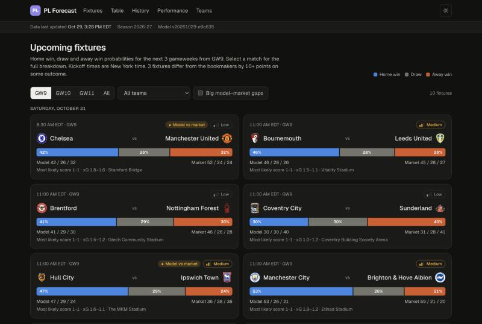
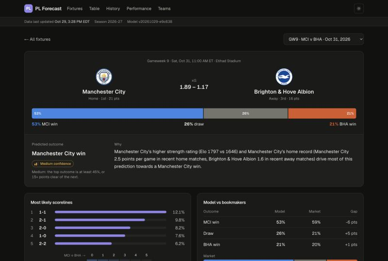
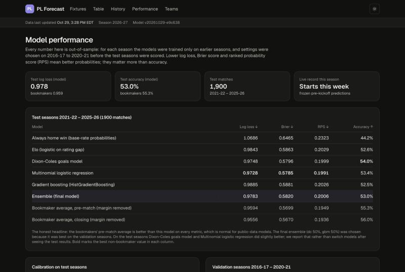

# PL Forecast: Premier League match predictions

A personal, educational project that predicts upcoming Premier League matches from real data,
explains each prediction, compares it with bookmaker odds, and keeps an honest, frozen record of
how it did. **Not a betting tool.**

| Fixtures | Match detail | Model performance |
|---|---|---|
|  |  |  |

What the dashboard shows:

* **Fixtures** for the next three gameweeks with a home / draw / away bar, confidence level, the
  bookmaker view and a flag where model and market differ by 10+ points; filter by gameweek, team
  or big disagreements.
* **Match page** for any upcoming fixture: probabilities (always summing to 100%), predicted
  outcome and confidence, a plain-English explanation, most likely scorelines with a score grid,
  expected goals, model vs bookmaker table, last-5 form with goals, league position / points /
  goal difference / points per game, home record of the home side and away record of the away side
  (this season and last, including Championship for promoted clubs), head-to-head (last 10 league
  meetings), xG / shots / shots on target / clean sheets, rest days since each team's last match in
  any competition, the model components and their weights, kickoff in New York time and venue.
* **Performance**: walk-forward log loss, Brier score, RPS and accuracy for every model and
  baseline and for the bookmakers, a calibration chart and per-season results.
* **History**: every finished 2026-27 match with the prediction on record before kickoff, the
  result, and a running record against the market.
* **Table** and **team pages** (Elo history, form trend, upcoming fixtures, per-game stats).
* "Data last updated" timestamp, source-failure banner, dark mode, mobile layout.

## Architecture

```
 football-data.co.uk ─┐  results, shots, odds (CSV)          GitHub Actions (cron)
 FPL public API ──────┼─► pipeline/ingest.py ─► SQLite ─► model/features.py ─► model/predict.py
 ESPN public API ─────┘  fixtures, kickoffs,   data/epl.sqlite   (leakage-safe)   (ensemble, scorelines,
                         venues, cups/Europe,                                      explanations)
                         DraftKings odds                                               │
                                                                                       ▼
                   data/ledger/predictions.csv ◄── freeze at kickoff ── model/ledger.py
                   (committed, append/lock only)                               │
                                                                               ▼
                               pipeline/export.py ─► web/public/data/*.json ─► git push
                                                                               │
                                     Vercel builds web/ (Next.js static export) ◄┘
```

* The **database** is SQLite (`data/epl.sqlite`). It can always be rebuilt from the sources, so it
  is cached between CI runs rather than committed. Tables: `teams`, `team_aliases` (the single
  name-mapping table), `matches` (Premier League and Championship, unique per division / season /
  home / away), `odds`, `other_matches` (cups and Europe, for rest days), `elo_history`,
  `predictions`, `pipeline_runs`, `source_status`. Every write is an upsert on a natural key, so
  re-running never duplicates anything. The schema is in [`pipeline/db.py`](pipeline/db.py).
* **Frozen predictions** live in `data/ledger/predictions.csv`, which is committed. A row can be
  refreshed until kickoff, then it is locked forever; git history is the audit trail.
* **Model versions** are saved in `model/artifacts/<version>/` (pickled model, manifest with
  hyper-parameters, training-data fingerprint and library versions). Each ledger row records the
  version that made it.
* The **site** is a static Next.js export built from `web/public/data/*.json`. If a pipeline run
  fails, nothing is committed and the live site keeps serving the last good data.

```
pipeline/   sources (football_data, fpl, espn), ingest, team mapping, db, export, CLI
model/      elo, dixon_coles, features, learners, evaluate, train, predict, explain, ledger
web/        Next.js 16 + TypeScript + Tailwind 4 dashboard
data/       teams.csv, team_aliases.csv, point_deductions.csv, ledger/  (raw/ + sqlite are ignored)
docs/       evaluation.md (generated), evaluation-notes.md, screenshots
tests/      pytest suite
.github/    workflows: update.yml (scheduled pipeline), ci.yml (tests + web build)
```

## Data sources, terms and limits

| Source | Used for | Key? | Terms / limits | How we use it |
|---|---|---|---|---|
| [football-data.co.uk](https://www.football-data.co.uk/data.php) | Premier League and Championship results 2004-05 to now, shots, cards, odds from many bookmakers (opening and closing), xG for 2026-27, odds for the next round (`fixtures.csv`) | No | Free for personal / research use; please don't hammer it | Finished seasons downloaded once; only the current season and `fixtures.csv` are refreshed, ≥1 s between requests |
| [Fantasy Premier League API](https://fantasy.premierleague.com/api/bootstrap-static/) | Fixture list, gameweeks, UTC kickoff times, postponements, live/final scores, club codes for crests | No | Unofficial, undocumented; personal use | 2 requests per run |
| ESPN site API (`site.api.espn.com`) | Venues, every club's cup and European fixtures (rest days), DraftKings moneyline odds for the next ~10 days | No | Unofficial, undocumented; may change without notice | ~50 requests per run (0.4 s apart); one-off ~400-request historical backfill. **Optional**: if it fails the pipeline continues and the banner shows the issue |
| Club crests (`resources.premierleague.com`) | Images on the dashboard | No | Crests are the clubs' trademarks; hot-linked for personal, non-commercial use | Loaded by the browser |

Sources I considered and did not use:
* **football-data.org** needs an API key and adds nothing the sources above do not already
  provide.
* **Understat** has free xG, but its `robots.txt` disallows all crawling.
* **FBref** no longer carries Opta xG, and its terms forbid scraping.

The consequence is that historical xG is not available. The model is trained on shots and shots
on target instead, and the dashboard shows real xG for 2026-27 from football-data.co.uk.

## Running it locally

Requirements: Python 3.12+ and Node 20+ (developed on Python 3.14 and Node 26). No API keys are
needed.

```bash
python3 -m venv .venv
```

```bash
.venv/bin/pip install -r requirements.txt
```

```bash
.venv/bin/python -m pipeline bootstrap
```

`bootstrap` downloads every season, backfills cup and European dates from ESPN, trains the model
(re-using the committed `model/artifacts/hyperparams.json`) and writes the dashboard data. It
takes about 5 minutes on a first run. Add `--evaluate` to also re-run the full walk-forward
evaluation, which takes about 10 more minutes.

Then build and preview the dashboard:

```bash
cd web && npm install && npm run build && npx serve out
```

Or use `npm run dev` in `web/` for live reload while editing the UI.

Day-to-day commands:

```bash
.venv/bin/python -m pipeline update
```

```bash
.venv/bin/python -m pipeline update --retrain
```

```bash
.venv/bin/python -m model.evaluate
```

```bash
.venv/bin/python -m pytest -q
```

## How the model works

1. **Elo** ratings run over the Premier League *and* Championship since 2004-05 (K = 10, goal
   difference multiplier, home advantage 95, 5% regression to the division mean each summer). This
   is how **promoted clubs** are handled: they arrive with the rating earned in the Championship,
   and points flow between divisions through promoted and relegated clubs. A promoted-club prior is
   also applied in Dixon-Coles.
2. **Dixon-Coles** goals model, refit twice a week on the last three seasons. Matches are weighted
   by recency (half-life about 8 months), ratings are shrunk towards a prior, and the target is 70%
   goals and 30% shots-on-target-implied goals. It gives expected goals and the full scoreline
   distribution.
3. **Gradient boosting** (scikit-learn `HistGradientBoostingClassifier`, depth-1 trees) uses 32
   pre-match features:
   * Elo ratings and the Dixon-Coles outputs
   * last-5 points per game, plus 10-match goal, shot and shots-on-target differences
   * home form of the home side and away form of the away side
   * season points per game, goal difference per game and league position
   * days of rest since the last match in any competition, and whether the club played in Europe
     within the last 5 days
   * promoted-club flags

   Missing values (for example, a promoted club's PL form) are handled natively.
4. **Final forecast** = 50% Dixon-Coles + 50% boosting. The weights and every hyper-parameter
   were chosen on the 2016-17 to 2020-21 validation seasons. **Bookmaker odds are never a model
   input**, so comparing the model with the market is fair.
5. **Explanations**: for each group of inputs (ratings, form, shots, home/away form, table, rest,
   promotion) the two teams are made equal on that group and the change in the predicted outcome's
   probability is measured. The biggest effects become the sentence on the match page.
6. **Confidence**:
   * high: the top outcome is at least 60%, or 30+ points clear of the next
   * medium: the top outcome is at least 45%, or 15+ points clear
   * otherwise low

**Leakage control.** Every feature is built from "state after match" rows joined to each fixture
with a strict *before kickoff* as-of join. League-table snapshots only count once a matchday's
games are over. Dixon-Coles only sees matches before its fit date. `tests/test_leakage.py`
checks this: it scrambles a match's own result and every later result, then asserts that the
match's features do not change.

## How it was evaluated

Walk-forward by season, no random splits. Each season is predicted by models trained only on
earlier seasons. Full tables are in [`docs/evaluation.md`](docs/evaluation.md) and the discussion
is in [`docs/evaluation-notes.md`](docs/evaluation-notes.md).

Test seasons 2021-22 to 2025-26 (1,900 matches):

| Model | Log loss | Brier | RPS | Accuracy |
|---|---:|---:|---:|---:|
| Always home win (base rates) | 1.069 | 0.647 | 0.232 | 44.2% |
| Elo | 0.984 | 0.586 | 0.203 | 52.6% |
| Dixon-Coles | 0.975 | 0.580 | 0.200 | 54.0% |
| **Final ensemble** | **0.978** | **0.582** | **0.201** | **53.0%** |
| Bookmakers (pre-match average) | 0.959 | 0.570 | 0.195 | 55.3% |

* The model clearly beats the naive baselines and is well calibrated.
* It does **not** beat the bookmakers. That is the expected result for a model that sees no team
  news.
* On the test seasons the plain Dixon-Coles model was slightly better than the ensemble that
  validation picked. That is reported, not tuned away.

**Known limitations:**
* No injuries, line-ups or team news.
* No historical xG for training.
* Early-season predictions for promoted clubs are the least reliable.
* ESPN's data is unofficial.
* Scoreline probabilities are approximate.

More detail is in the notes.

## Scheduled updates

[`.github/workflows/update.yml`](.github/workflows/update.yml) runs on GitHub Actions on this
schedule:

| When (UTC) | What |
|---|---|
| Every 3 hours (`17 */3 * * *`) | Fetch results, fixtures, odds and cup dates. Update Elo and features. Refresh predictions for the next 3 gameweeks. Lock predictions whose match has kicked off. Log finished matches. Export JSON. Commit. |
| Hourly 10:47–20:47 on Saturdays and Sundays | The same, more often on match days, so the frozen prediction is close to kickoff. |
| Tuesdays 06:05 | The same plus `--retrain`: the production model is refit on all finished matches and saved as a new version. |

Each commit to `main` triggers a Vercel deploy of `web/`.

**Failure handling:**
* football-data.co.uk and FPL are required. If either is down or changes format (HTML instead
  of CSV, missing columns, unknown team names), the run fails with a clear error.
* On a failed run nothing is committed, so the site keeps the last good data, and GitHub emails
  the repository owner.
* ESPN failures are recorded but don't stop the run. The dashboard banner names any failing
  source.
* Commits that would only bump the "last updated" time are limited to one every 12 hours, to keep
  the git history small.

To trigger a run manually, open GitHub → Actions → "Update data and predictions" → Run workflow.
Tick "retrain" or "evaluate" if you want those too. Locally, run
`python -m pipeline update [--retrain]`.

Note: GitHub disables scheduled workflows after 60 days with no repository activity. The bot's
own commits count as activity, so this should not happen while matches are being played.

**Edge cases the pipeline handles:**
* **Postponed matches**: FPL clears the kickoff, so the match shows as postponed and an unlocked
  prediction is kept for the new date.
* **Rescheduled matches**: predictions are keyed by match, not date.
* **Season rollover**: the current season comes from FPL's fixture list. The new season's CSV
  may 404 for a while, and pre-season ratings regression is applied.
* **Off-season**: an empty fixture list renders an empty state.
* **Missing stats**: NaN-tolerant features.
* **Results before football-data updates**: FPL scores fill the gap.

## Environment variables and secrets

**No API keys or secrets are required.** [`.env.example`](.env.example) lists optional overrides:
`EPL_DB_PATH`, `EPL_DATA_DIR`, `EPL_WEB_DATA_DIR` and `EPL_USER_AGENT`. `.env` files are
git-ignored.

Deployment needs only the Vercel ↔ GitHub connection:
* import the repo in Vercel
* set the Root Directory to `web`
* use the default framework settings (Next.js)

The workflow pushes with the built-in `GITHUB_TOKEN`, which needs "Read and write permissions"
under Settings → Actions → General.

## Disclaimer

For personal and educational use only. Not betting advice. Data belongs to its respective
providers; club crests are trademarks of their clubs.
